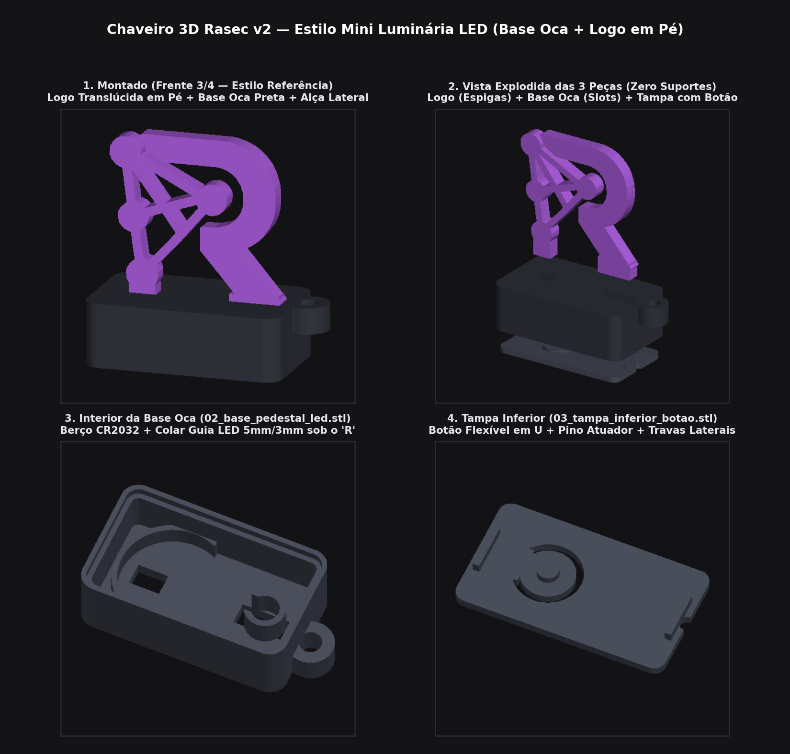

# Chaveiro 3D Rasec — Guia de Impressão 3D, Cotação e Montagem LED

> **Visualizador 3D Interativo (com Visão Explodida + Download dos STLs):**  
> 👉 **[https://gitakzo.github.io/chaveiro/](https://gitakzo.github.io/chaveiro/)**



## Resumo para Cotação (Papelaria / Birô de Impressão 3D)

- **Tamanho total montado:** `4,84 cm` (largura) × `4,66 cm` (altura) × `2,50 cm` (profundidade)
- **Quantidade de peças:** 3 arquivos `.stl` (**100% manifold / watertight**, sem erros de malha)
- **Suportes necessários:** **Nenhum (Zero suportes)** — todas as 3 peças já estão orientadas para imprimir direto na mesa
- **Peso total estimado (PLA/PETG):** ~`11,8 g` (sem eletrônica)

| Arquivo STL | Dimensões (mm) | Peso Est. | Material / Cor Recomendada | Orientação na Mesa |
| --- | --- | --- | --- | --- |
| [`stl/01_logo_translucida_vertical.stl`](stl/01_logo_translucida_vertical.stl) | `36.7 × 37.0 × 3.8` | ~3,4 g | **PETG ou PLA Roxo Translúcido** *(ou Cristal/Branco)* | Deitada (`Z = 0`) |
| [`stl/02_base_pedestal_led.stl`](stl/02_base_pedestal_led.stl) | `48.4 × 25.0 × 13.5` | ~6,7 g | **PLA ou PETG Preto Fosco** | **De cabeça para baixo** (topo com slots na mesa) |
| [`stl/03_tampa_inferior_botao.stl`](stl/03_tampa_inferior_botao.stl) | `39.5 × 22.5 × 3.3` | ~1,7 g | **PLA ou PETG Preto Fosco** *(PETG recomendado p/ botão)* | Plana (`Z = 0`) |

## Parâmetros Recomendados de Impressão (FDM)

- **Bico:** `0.4 mm`
- **Altura de camada:** `0.20 mm` *(ou `0.16 mm` para melhor acabamento)*
- **Paredes (Perímetros):** `3`
- **Preenchimento (Infill):**
  - **Logo Translúcida (`01`):** `100%` retilíneo alinhado *(maximiza a passagem de luz do LED)*
  - **Base Oca (`02`) e Tampa (`03`):** `20%` Gyroid
- **Suportes:** **Desativados**

## Montagem do Circuito LED (Sem Solda)

**Materiais:** `1x LED 5 mm ou 3 mm` (Branco Frio, Roxo ou UV ~3V) + `1x Bateria moeda CR2032 (3V)`.

1. Com a base `02_base_pedestal_led.stl` virada de cabeça para baixo, encaixe o bulbo do LED no **colar guia direito** (apontando para cima, direto no slot da perna do "R").
2. Dobre a perna **curta (`-`, cátodo)** até o fundo do berço da bateria e coloque a **CR2032** com o polo `-` para baixo (encostando na perna curta).
3. Dobre a perna **longa (`+`, ânodo)** passando ~1 mm acima do centro do polo `+` da bateria (sem encostar em repouso).
4. Encaixe a tampa `03_tampa_inferior_botao.stl` no rebaixo inferior — ao apertar o **botão flexível em "U"** embaixo da base, o pino interno pressiona o terminal `+` contra a bateria e a logo acende; ao soltar, apaga.
5. Encaixe a logo `01_logo_translucida_vertical.stl` nos dois slots do topo (folga `0.25 mm`; use 1 gotinha de cola cianoacrilato apenas nas espigas se desejar travamento permanente).

## Regenerando os STLs e o Visualizador 3D

```bash
pip install -r requirements.txt
python generate_keychain.py
python build_viewer.py
```
